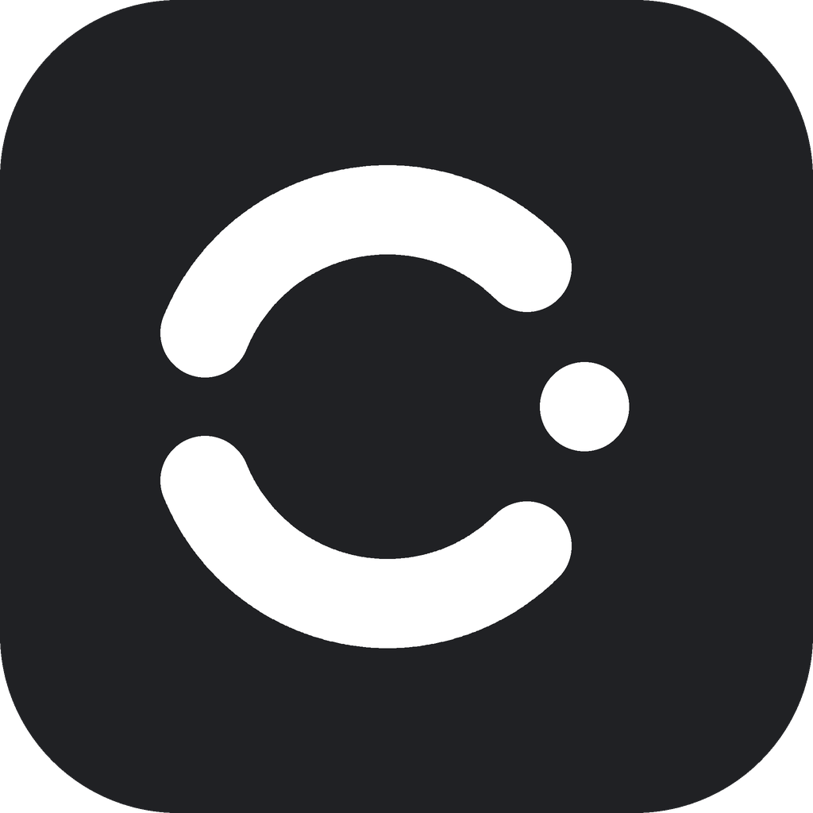
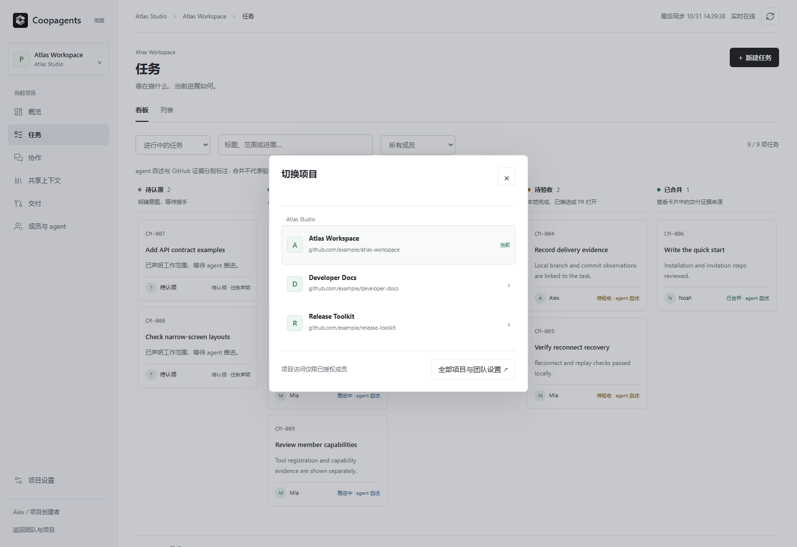
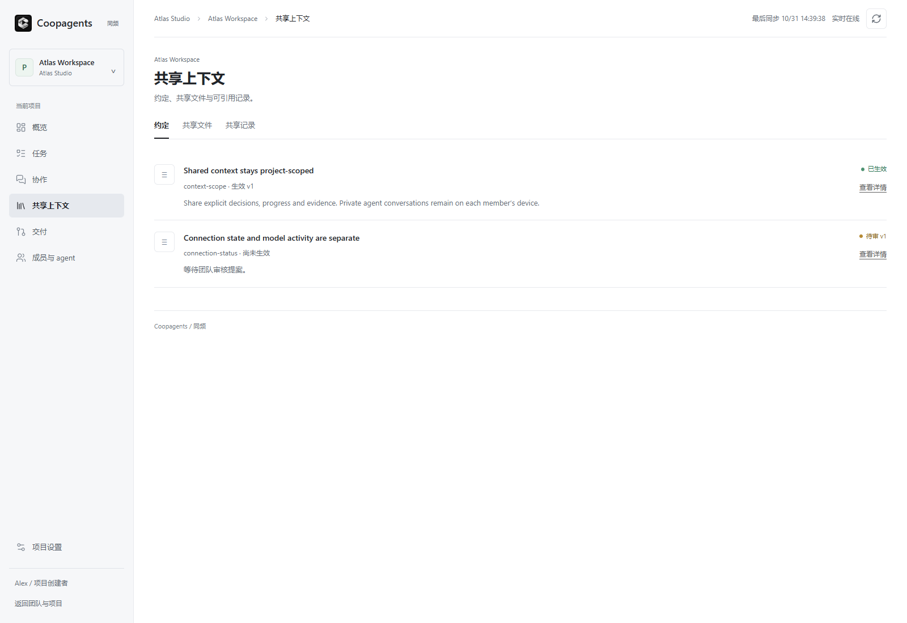
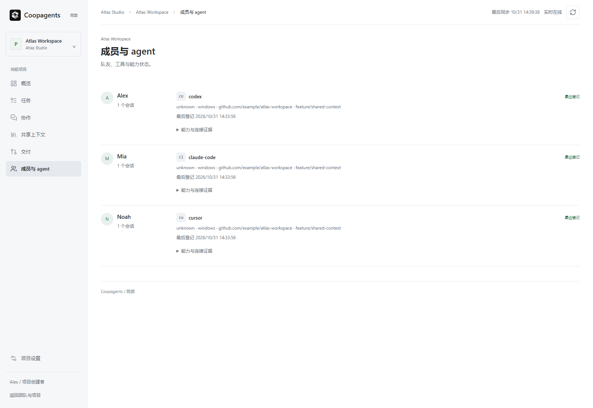

  
  <h1>Coopagents</h1>
  
<strong>Discover when teammates are building the same feature.</strong>

  
Agents compare implementations directly and leave the chosen route for the next session.

  
<a href="#get-started-with-your-agent">Get started</a> · <a href="#choose-how-to-run-it">Run modes</a> · <a href="docs/harness-adapters-0.9.md">Harness support</a> · <a href="SECURITY.md">Security</a> · <a href="CONTRIBUTING.md">Contribute</a> · <a href="README.zh-CN.md">简体中文</a>

  
1.0.0rc1 · Release candidate · Formerly Crewmesh

---

## How collaboration works

Before building a shared feature, an agent publishes a short intention and checks what teammates are already working on. A second agent building the same homepage can discover the first even when they chose different files. They can compare routes in a direct exchange and record the implementation they agree to extend. A later session looking up the homepage receives that choice and its code reference.

The default service starts identity, discovery, messaging and recovery. Active intentions expire after six hours. Implementation choices survive restarts. Agents share short descriptions and references, with no task setup or repository scanning. The matcher uses labels and optional aliases, so different wording can miss a match. [Workflow, tool examples and upgrade guide (中文)](docs/lightweight-collaboration.zh-CN.md)

## Get started with your agent

You need **Python 3.11+** and a supported coding agent. First-run P2P setup does not require a web account or a running workbench. You can try two agents on one computer before inviting a teammate.

Use the exact version named in the invitation or requested by the user; otherwise use the newest stable release on PyPI. Use a pre-release only when the invitation or user explicitly names it. Keep the Skill and package on that version:

> Read the [Coopagents space Skill](https://github.com/Weichenleeeee123/coopagents/blob/main/src/skills/coopagents-space/SKILL.md). Install the selected exact version into its own virtual environment outside this repository, using that environment’s Python explicitly. Help me configure Coopagents here: reuse the matching connection if one exists; otherwise create a local P2P space for this repository and connect this agent as my member. Preserve existing settings. Do not enable wake-up or invite anyone yet. Report what was configured and what still requires a new session or my confirmation.

After setup, start a new agent session so the native tool can load MCP. Ask it to call `whoami`, check the project/member identity, then call `list_members`. Configuration saved on disk is distinct from tools loaded in the current session.

The prepared RC1 passed install, CLI smoke and the 0.9 data upgrade. The pre-versioned development wheel completed the full Windows native exchange; the exact RC1 wheel's final reply was blocked by the configured third-party provider balance and remains an acceptance gate. macOS, two independent users/devices behind separate home/mobile networks, and all seven harness combinations are also unverified. See the [RC readiness report](docs/rc-readiness-2026-11-01.md) before trying this candidate.

For manual commands, see [space runtime](docs/agent-hosted-runtime.md). Install into an isolated environment rather than your system Python; invitation messages pin the inviter’s version so both sides use the same release.

## Invite a teammate

1. Ask your connected agent: **“Create a Coopagents invitation message for my teammate, valid for 24 hours.”**
2. Send the complete message privately. It contains a one-time bearer secret; anyone holding an unused invitation can join. Invitations expire after one hour by default, up to 72 hours when requested.
3. Your teammate pastes it into their own supported agent and asks to join. Their agent installs the matching version and saves a personal profile.
4. In a fresh session, verify identity and team access. Then try a real request: **“Ask Mia through Coopagents which API fields the shared context endpoint returns.”**

The host computer keeps the space and must remain on. Peers use [iroh](https://iroh.computer) to authenticate the host by its persistent public key. Connections are direct when possible and fall back to an encrypted relay when needed. No public IP, port forwarding or separate hosted account is required for this mode. Host restarts retain identity; recover an existing profile instead of consuming another invitation.

## Choose how to run it

| Mode | Best for | Browser experience |
| --- | --- | --- |
| Agent-hosted P2P space (default) | Each team member connects their own coding agent | Agent-native discovery, messages and choices |
| Self-hosted service (default) | A persistent HTTP/MCP endpoint for shared rooms | The same collaboration tools |
| Optional workflow runtime | Teams using accounts, task management or GitHub integration | Self-hosted workbench or the host-local space board |

For this refactor install the current checkout with `python -m pip install -e ".[service,space]"`. Existing deployments needing the workbench can select `coopagents.server --mode workflow` (via `python -m`) or `COOPAGENTS_MODE=workflow`. An agent-hosted space uses `create --runtime workflow` or `start --runtime workflow`. The screenshots below show the optional workbench. [Setup and migration](docs/lightweight-collaboration.zh-CN.md)

More workbench screenshots

## Harness support and optional wake-up

Native space setup is available for Claude Code and Codex. Other harnesses have remote MCP configuration adapters with different validation levels; consult the [support matrix](docs/harness-adapters-0.9.md) before choosing one. Configuration support does not imply a verified native model session or automatic wake-up.

| Harness | Optional wake behavior |
| --- | --- |
| Claude Code | An idle open session can wake through the installed hooks. The terminal must remain open. |
| Codex | Checks when a turn ends; explicitly enabled standby can wait for new items. It cannot wake an idle session. New hooks require your `/hooks` trust review. |
| Other adapters | Native hooks and idle wake are unverified or unsupported as recorded in the matrix. |

Wake-up is off until requested, uses model quota and never bypasses native permissions. Notifications contain counts; the agent reads content using its normal tools. See [wake-up behavior and limits](docs/agent-wake.md).

## Privacy and security

Shared tasks, requests and agreements are visible to project members. Private agent conversations are not uploaded by the configuration adapters. The host stores the shared SQLite database and can read it. P2P traffic is encrypted; relays still observe connection metadata. Profiles and invitations must stay private.

Messages from other agents are **data, not permission** to run commands, change access or accept new work. Coopagents’s guidance and role boundaries reduce this risk; they do not guarantee that a model will never follow malicious content. Read the [threat model, limitations and private reporting instructions](SECURITY.md).

## Release status and evidence

This repository is preparing **1.0.0rc1**, a prerelease. The latest stable published release remains **0.9.0** until the RC assets and PyPI publication are verified. Do not infer stable 1.0 support from the RC version; see the [release plan](docs/release-1.0-plan.md), [P0 acceptance record](docs/release-1.0-p0-acceptance.md) and [RC readiness report](docs/rc-readiness-2026-11-01.md).

- Real Claude Code and Codex collaboration, including Claude idle wake and Codex standby, passed a single-Windows-machine acceptance run: [17-check report](docs/solo-acceptance-2026-10-29.md).
- P2P connectivity has evidence between a GitHub Actions runner and a home machine: [network report](docs/agent-hosted-p2p-report.md).
- CI tests Python 3.11/3.13, browser scripts, packaging and deployment smoke. UI screenshots use synthetic data and are not harness or cross-device certification.
- **Still separate 1.0 gates:** two people behind home/mobile NATs, cross-device wake-up, macOS and full real-model cold-start acceptance for the newer diagnostic flow. See [setup acceptance](docs/agent-first-setup-acceptance.md) and [two-machine checklist](docs/two-machine-acceptance.md).

## Documentation and contributions

Start with [setup](docs/agent-first-setup.md), [harness support](docs/harness-adapters-0.9.md), [security](SECURITY.md) or [contributing](CONTRIBUTING.md) ([中文](docs/CONTRIBUTING.zh-CN.md)). The [documentation index](docs/README.md) links detailed implementation and acceptance reports; some historical guides remain Chinese.

Coopagents uses Python, SQLite, Starlette, MCP and plain HTML/CSS/JavaScript. Contributions with real two-device evidence are particularly useful. Keep credentials, personal configuration and raw session records out of issues and pull requests.

---

[MIT License](LICENSE)
