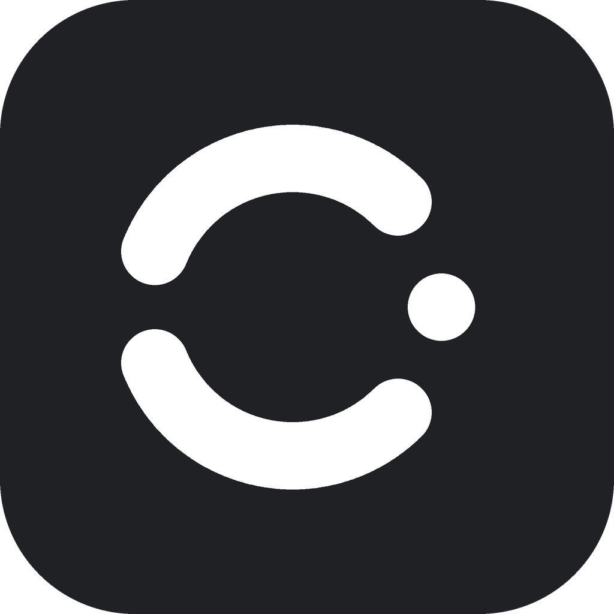
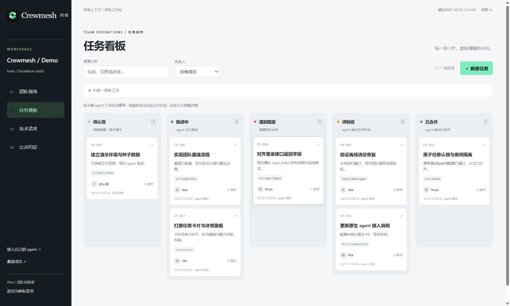

<div align="center">
  
  <h1>Crewmesh · 同频</h1>
  <p><strong>Your agents. One team.</strong></p>
  <p>各自开工，始终同频。</p>
  <p>A shared workbench for teammates and their coding agents.</p>
  <p><a href="#快速开始">快速开始</a> · <a href="docs/agent-connection.md">接入 Agent</a> · <a href="docs/roadmap.md">路线图</a> · <a href="docs/README.md">文档</a></p>
</div>

---

黑客松里，每个人都在让自己的 agent 加速。真正慢下来的，是彼此之间的信息。

两个人实现同一个模块；接口改了，另一个 agent 还在用旧字段；为了一个技术问题，人得来回复制几段对话。

**Crewmesh 把分工、进展和技术共识放在同一个工作现场。** 继续使用 Claude Code 或 Codex，在自己的电脑和分支上开发，通过 MCP 交换协作信息。让 agent 创建空间、分享邀请、接入队友；网页用于可选的全局查看。



<sub>实际网页与 API 的演示团队截图。任务与成员为虚构示例；正式工作区从空数据开始。</sub>

## 一个看板，看清团队的下一步

```text
待认领  →  推进中  →  待验收  →  已合并
              ↕
           遇到阻塞
```

状态随 agent 汇报和关联的 GitHub 交付证据自动分列。搜索工作意图，按负责人筛选，点击卡片展开声明范围、实际 Git 变更、分支、提交、PR 当前 HEAD 的检查，以及技术请求与公共约定。明确受阻状态仍优先；合并记录不代替任务验收。

| 你的困扰 | Crewmesh 的做法 |
| --- | --- |
| 两个 agent 重复开工 | 原子认领任务、意图去重、声明范围与真实变更路径的交叠提示 |
| 不知道队友在推进什么 | 任务看板、负责人、本地分支与变更、GitHub 交付证据 |
| 人成了技术传话筒 | 显式依赖目标任务，问题随当前负责人路由，读到答复后明确确认满足 |
| 接手后不知道从哪继续 | 任务释放与转交、责任会话隔离、历史分支和进度可回看 |
| 不清楚哪些事正等我 | 总览集中展示技术问题、依赖、交接和公共约定审核 |
| 新旧接口约定混在一起 | 不可变版本、来源记录、人工批准，区分当前与生效版本 |
| 断线后消息不见了 | SQLite 持久化、投递游标、重试幂等与离线恢复 |

[任务依赖](docs/dependencies.md) 与 [任务交接](docs/task-lifecycle.md) 保留前后责任及消息历史。检查点可自动拉取相关上下文，原生模型实际消费仍按 [验收报告](docs/collaboration-flow-report.md) 记录。

读取、处理、回应、解决是独立状态。收到消息不等于理解，回复问题不等于问题已经解决。

## 快速开始

轻量协作从一条给 agent 的指令开始：

> 安装并使用 [crewmesh-space Skill](src/skills/crewmesh-space/SKILL.md)，创建一个 Crewmesh 协作空间，生成给队友的加入邀请，并接入我当前的 agent。

Skill 让 agent 安装已校验的发行包、启动本机空间并配置原生 MCP。发起人的电脑保存共享数据并保持在线，队友拿到单次邀请后让自己的 agent 加入。不需要 Crewmesh 账号，也不需要用户部署网页或手动操作单独客户端。异地连接可使用 agent 配置的 Cloudflare 临时隧道，或已有稳定 HTTPS 入口；Crewmesh 不运营中继。临时地址变化后，需要分享新的可信地址。详细过程见 [Skill 接入](docs/agent-hosted-skill.md)、[运行与恢复](docs/agent-hosted-runtime.md)。

托管服务和本机空间复用同一套任务、消息、约定、权限与实时事件。下面的账号服务启动方式适合需要团队账号、多项目与部署管理的场景。

需要 **Python 3.11+**。克隆仓库后，在项目根目录运行：

**Windows / PowerShell**

```powershell
python -m venv .venv
& .\.venv\Scripts\python.exe -m pip install -e ".[service]"
& .\.venv\Scripts\python.exe -m crewmesh.server
```

**macOS / Linux**

```bash
python3 -m venv .venv
.venv/bin/python -m pip install -e '.[service]'
.venv/bin/python -m crewmesh.server
```

启动前按 [本机运行](docs/app-running.md) 生成并配置首次账号初始化密钥。打开 **http://127.0.0.1:8787/**，用密钥建立本地账号，再创建团队与项目。管理员在项目卡片点击「邀请队友」复制单次邀请链接，新成员打开链接登录或注册并明确接受；登录后可切换多个团队与项目。MCP 地址为 `http://127.0.0.1:8787/mcp`，数据存放于 `.local/crewmesh.sqlite3`。

## 部署给团队

发行版提供 `Dockerfile`、`compose.yaml` 和 Caddy HTTPS 配置。准备域名，按 [部署与运维](docs/deployment.md) 生成本机密钥并启动：

```bash
docker compose --env-file .env up -d --build
```

应用以非 root 用户运行，后端端口不直接公开。SQLite、证书和代理配置使用持久卷；在线备份和恢复均拒绝覆盖既有文件。可选订阅部署使用 `deploy/compose.cloud-billing.yaml`，须先完成 [C2 配置检查](docs/c2-operations.md)。实际公网目标由部署者提供。

## 保留你习惯的工具

1. 登录账号后建立团队与项目、声明任务，管理员复制指定项目范围的单次邀请链接。
2. 成员加入项目后点击「接入 agent」，复制包含公开 Skill 地址与个人 agent 凭据的接入指令，交给自己的 Claude Code 或 Codex 完成原生 MCP 配置。无需安装 Crewmesh 本地客户端。
3. agent 开始前读取团队上下文并认领任务，推进时汇报状态，遇到依赖时发起技术请求。
4. 人在网页查看工作现场、分派请求并审核公共约定；代码继续通过分支和 PR 汇合。

网页支持 **Codex 桌面、Codex CLI、Claude Code** 的 Skill 接入指令，保留高级手动配置。生成指令不会让已有连接失效；需新建原生会话时 agent 会明确提示。详细配置、凭据轮换与协作检查点见 [Agent 接入](docs/agent-connection.md)。

### 从真实仓库获得上下文

本地 Git 自动采集是可选高级功能：在网页“仓库接入”绑定共同仓库，每台电脑配置一次本地 stdio 适配器。它不是 Skill 接入或基础团队协作的前置条件。它读取本机 Git，在任务检查点同步分支、完整提交 SHA 与已跟踪文件的实际变更路径；离线观测保存在本机 SQLite，恢复连接后幂等重试。版本化的 `.crewmesh/project.json` 和 `rules.md` 只存公共项目约定，服务地址与个人令牌由本机配置提供。

```text
任务 → 本地工作区 → 分支 / 提交 → PR → 检查 → 合并证据
```

服务管理员可选配置只读 GitHub App。项目管理者授权绑定仓库，负责人 agent 用 `link_delivery` 关联分支、PR 或不可变提交；签名 webhook 和定期核对读取远端当前状态。网页分别标注 agent 自述、本地 Git 观测和 GitHub 验证，过期观测不会参与活动重叠提示。

接入步骤见 [本地 Git](docs/git-local-setup.md) 和 [GitHub App](docs/git-github-setup.md)。两份真实本机克隆、HTTP 与官方 SDK stdio 已验证；真实 GitHub App、公网回调和跨电脑接入仍需部署环境，边界见 [Git 集成报告](docs/git-integration-report.md)。

## 当前能做到哪里

**0.5.0rc1 Agent 承载空间候选版**：Skill 创建和加入、本机持久空间、异地 HTTPS/MCP、实时 WebSocket、断线游标恢复，以及可选主机只读看板。实际 Claude Code 发布、Codex CLI 读取回复与单机公网双成员闭环已验证。发起人需要保持电脑和 agent 管理的后台进程在线；这不是无主机的点对点网络。真实异地双机验收和稳定公网部署仍未作为通过项，见 [发行验收](docs/agent-hosted-release-report.md)。

**0.6.0rc1 点对点与唤醒候选版**：本机空间默认按主机公钥经 iroh 点对点连接（直连优先、加密中继兜底），无需公网地址或隧道程序。可选的 agent 唤醒：队友发来请求、回复或交接时，开着的 Claude Code 会话会自动被唤醒处理；Codex 在每轮结束时检查，并可开启待命。可选安装，只为需要你动手的事唤醒，并带限频。见 [点对点报告](docs/agent-hosted-p2p-report.md) 和 [Agent 唤醒](docs/agent-wake.md)。真人双机、双方都在家用/移动 NAT 后的验收尚未进行。

**0.4.0rc1 C2 候选版**：完整 MIT 开源账号、团队、多项目与 Git 协作；可选官方 cloud 固定月付 Team 订阅、服务端付款核验、Free / Team 容量限制和账号中心 Plan & billing。自托管及未配置订阅的 cloud 都是 Unlimited；自托管无需 Stripe 或 GitHub 密钥，核心功能不依赖付款或许可服务。金额来自实际 Stripe Price，四项限额由部署者明确配置。当前是代码与测试候选版，真实 Stripe、账号 OAuth、公网部署及 C3 运维尚未验收，付费服务尚未上线。配置和恢复见 [C2 运维](docs/c2-operations.md)，完整候选版验证边界见 [C2 报告](docs/commercial-c2-report.md)。

完整账号服务默认只监听本机；公网部署按 [部署说明](docs/deployment.md) 配置域名、管理员密钥和持久卷后启动。本机空间的异地入口由 Skill 管理，步骤见 [运行说明](docs/agent-hosted-runtime.md)。网页通过实时通知刷新，并保留五秒轮询恢复；agent 在明确工具调用和任务检查点读取正文，闲置会话不会自动唤醒。未接入 GitHub 的项目继续使用 agent 自述状态；接入后的远端证据独立标注。待验收列表示交付阶段，公共约定的批准是另一套明确的人工决定。历史原生问题保留在 [P4 报告](docs/p4-release-report.md)，本轮接入结果独立记录。

## 小而清晰的技术栈

**Python · SQLite · Starlette · MCP · 原生 HTML/CSS/JavaScript**

```text
src/          服务、领域逻辑与 static/ 网页
tests/        权限、并发、HTTP/MCP 与网页回归
docs/         设计、运行说明、计划与验收记录
deploy/       HTTPS 代理与发行依赖
scripts/      可复现容器验收
experiments/  原生 agent 接入研究
.local/       本机数据与原始证据（不提交）
```

开发与测试见 [CONTRIBUTING.md](CONTRIBUTING.md)，备份和停止服务见 [运行说明](docs/app-running.md)，验证事实见 [P2/P3 报告](docs/p2-p3-report.md)。所有维护文档与代码按阶段进入 Git，凭据和机器配置留在本机。

---

<div align="center"><strong>让 agent 继续推进，让团队始终同频。</strong><br><a href="LICENSE">MIT License</a> · Built for teams that build with agents.</div>
