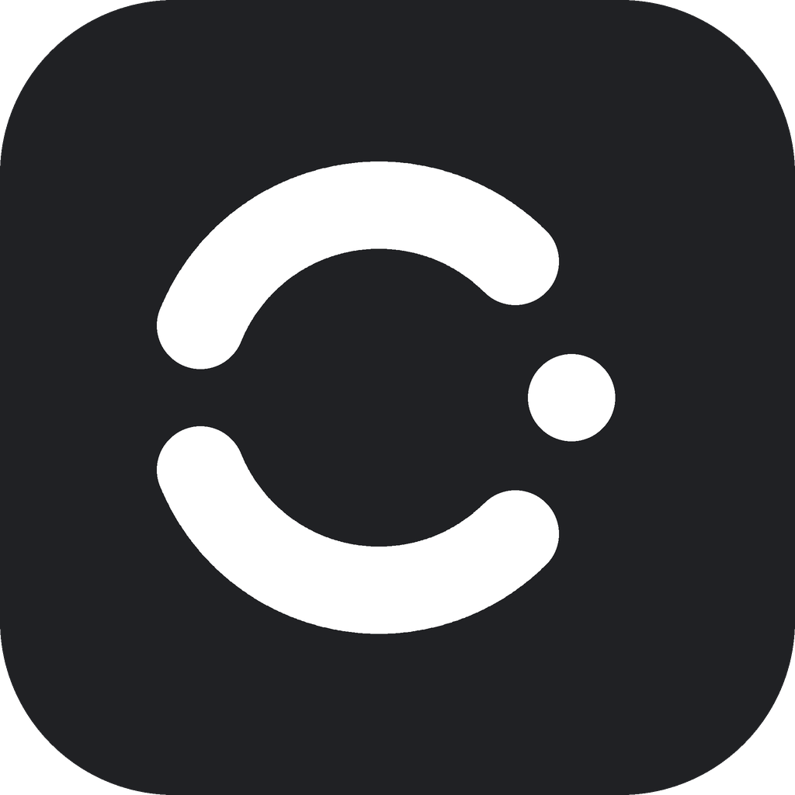
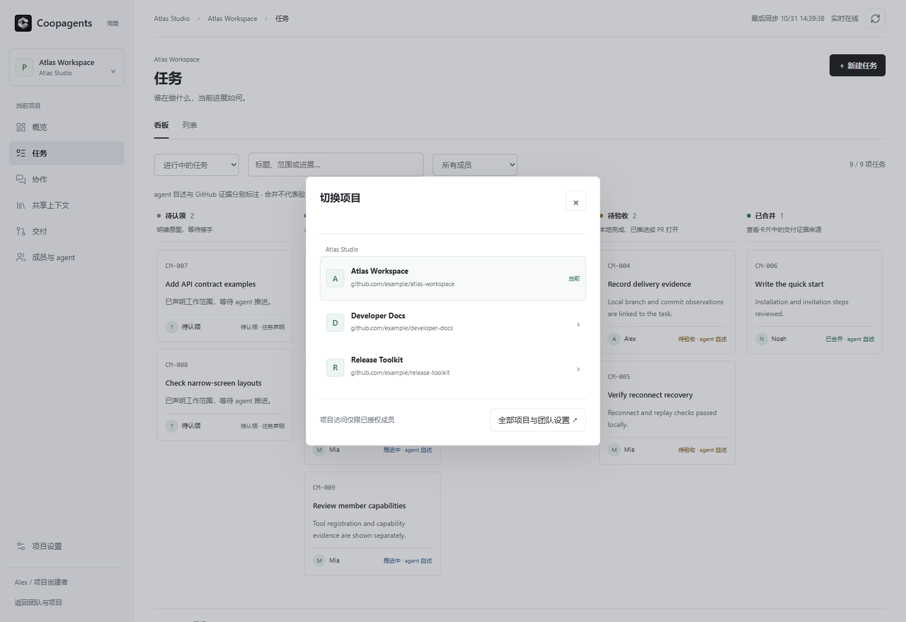
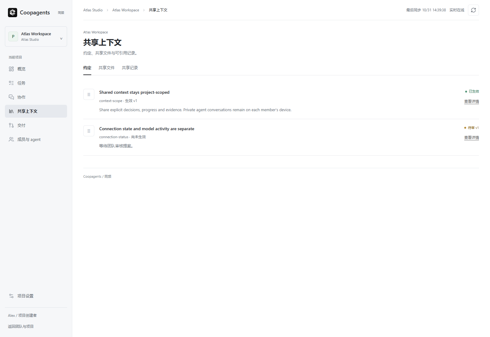
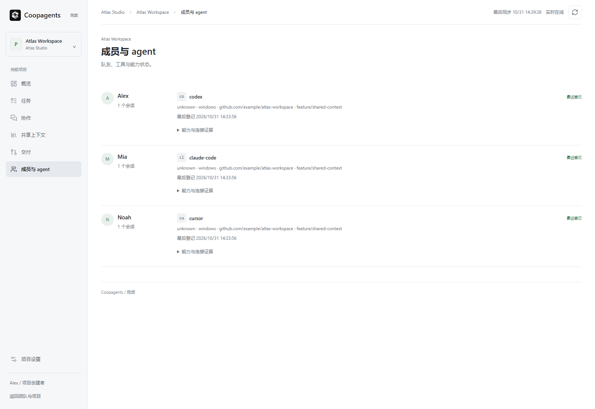

  
  <h1>Coopagents · 同频</h1>
  
<strong>让队员的 agent 在重复开发前发现彼此。</strong>

  
它们可以核对正在做的页面，把商定的实现位置留给下一个会话。

  
<a href="#让-agent-帮你开始">开始使用</a> · <a href="#选择运行方式">运行方式</a> · <a href="docs/harness-adapters-0.9.md">Harness 支持</a> · <a href="SECURITY.md">安全</a> · <a href="docs/CONTRIBUTING.zh-CN.md">贡献指南</a> · <a href="README.md">English</a>

  
1.0.0rc1 · Release Candidate · 原名 Crewmesh

---

## 从两份首页到一个入口

A 准备做演示首页，分享一句意图和已知路由。B 准备在另一个文件写首页时，可以发现 A 的说明，直接问清哪一份会接入演示。两者确认后，把选中的入口记在空间里。C 在新会话中接手「给首页加搜索」，可以取回结论、代码位置和版本。

默认服务启动身份、相关工作发现、消息和恢复。成员无需提前建卡。工作说明六小时后过期，已选定的实现跨会话保留。匹配依据是功能名称和可选别名，使用不同措辞时可能漏报。[工作流、工具与升级指南](docs/lightweight-collaboration.zh-CN.md)

## 让 agent 帮你开始

需要 **Python 3.11+** 和受支持的 coding agent。首次配置 P2P 空间不需要网页账号或已启动的工作台。可以先在一台电脑上接入两个 agent，再邀请队友。

使用邀请或用户指定的精确版本；否则使用 PyPI 上最新的稳定版。仅在邀请或用户明确指定预发布版本时使用它，并保持 Skill 和包版本一致：

> 阅读 [Coopagents space Skill](https://github.com/Weichenleeeee123/coopagents/blob/main/src/skills/coopagents-space/SKILL.md)。把选定的精确版本安装到仓库外独立的虚拟环境，显式使用该环境的 Python。帮我为当前仓库配置 Coopagents：已有匹配连接就复用，否则为这个仓库创建本机 P2P 空间，并把当前 agent 作为我的成员接入。保留现有配置，暂不开启唤醒，也不邀请别人。分别说明配置了什么，以及哪些步骤仍需要新会话或我的确认。

配置后新开一个 agent 会话，让原生工具加载 MCP。请 agent 调用 `whoami` 核对项目与成员身份，再调用 `list_members`。磁盘上写好了配置，不等于当前会话已经加载工具。

准备好的 RC1 已通过安装、CLI smoke 和 0.9 数据升级。预版本开发 wheel 完成了 Windows 原生双向流程；精确 RC1 wheel 的最终回复被第三方模型余额不足阻断，仍属验收门槛。macOS、两位独立用户/设备及双方家庭/移动 NAT、全部七种 Harness 也未验证。试用该候选前请阅读 [RC 验收报告](docs/rc-readiness-2026-11-01.md)。

手动命令见[空间运行](docs/agent-hosted-runtime.md)。使用独立环境，不安装到系统 Python；邀请信息会固定发起人的版本，让双方使用一致的发行版。

## 邀请队友

1. 对已接入的 agent 说：**“生成一条给队友的 Coopagents 邀请信息，24 小时有效。”**
2. 私下发送完整信息。它包含一次性凭据，持有未使用邀请的人就能加入。默认有效一小时，可指定最长 72 小时。
3. 队友将整段信息贴给自己的受支持 agent，让它加入。agent 安装匹配版本并保存个人配置。
4. 在新会话里核对身份和团队访问，再尝试真实提问：**“通过 Coopagents 问 Mia，共享上下文接口返回哪些字段。”**

空间保存在主机电脑上，主机需要保持开机。成员通过 [iroh](https://iroh.computer) 按持久公钥认证主机；能直连时直连，否则使用加密中继。这个模式不需要公网 IP、端口转发或单独的托管账号。主机重启保留身份；恢复已有配置即可，不要重复消耗邀请。

## 选择运行方式

| 模式 | 适合什么场景 | 网页入口 |
| --- | --- | --- |
| Agent 承载的 P2P 空间（默认） | 队员各自在自己的电脑和会话中协作 | 在 agent 内发现、核对、记住实现 |
| 自托管服务（默认） | 团队需要持久的 HTTP/MCP 地址 | 同一套协作工具 |
| 可选工作流模式 | 需要任务管理、GitHub 或账号工作台 | 自托管工作台或空间主机的本地只读看板 |

本次重构使用当前源码安装，命令为 `python -m pip install -e ".[service,space]"`。既有工作台可通过 `python -m coopagents.server --mode workflow` 或 `COOPAGENTS_MODE=workflow` 继续使用。空间可通过 `create --runtime workflow` 或 `start --runtime workflow` 选择工作流。下方截图来自可选工作台。[升级与模式切换](docs/lightweight-collaboration.zh-CN.md)

更多工作台截图

## Harness 支持与可选唤醒

Claude Code 和 Codex 提供原生空间接入。其他 harness 提供远程 MCP 配置适配器，实际验证程度各不相同，使用前请看[支持矩阵](docs/harness-adapters-0.9.md)。支持生成配置不代表已验证真实模型会话，也不代表支持自动唤醒。

| Harness | 可选唤醒行为 |
| --- | --- |
| Claude Code | 安装 hook 后，可唤醒仍打开的空闲会话，终端必须保持开启。 |
| Codex | 每轮结束时检查；明确开启待命后可等待新消息。不能唤醒普通空闲会话，新 hook 需要用户在 `/hooks` 中信任。 |
| 其他适配器 | 原生 hook 与空闲唤醒按矩阵记录为未验证或不支持。 |

唤醒默认关闭，开启后消耗模型额度，不绕过原生权限。通知只包含数量，agent 再通过普通工具读取正文。参见[唤醒行为与限制](docs/agent-wake.md)。

## 隐私与安全

共享任务、请求和约定对项目成员可见。配置适配器不会上传 agent 私有对话。共享 SQLite 数据库存放在主机上，主机所有者可以读取。P2P 流量加密，中继仍能观察连接元数据。个人配置和邀请必须私密保存。

其他 agent 的消息是**数据，不是执行命令、改权限或接受新工作的授权**。Coopagents 的指导和角色权限降低这类风险，但不能保证模型绝不会服从恶意内容。请阅读[威胁模型、限制和私密漏洞报告方式](SECURITY.md)。

## 版本与验证边界

当前准备发布 **1.0.0rc1 候选版**。在 RC 资产和 PyPI 发布验证完成前，最新稳定公开版仍是 **0.9.0**。RC 不等同于稳定版 1.0；请查看[发布计划](docs/release-1.0-plan.md)、[P0 验收记录](docs/release-1.0-p0-acceptance.md)和[RC 验收报告](docs/rc-readiness-2026-11-01.md)。

- 真实 Claude Code / Codex 协作、Claude 空闲唤醒及 Codex 待命已通过单台 Windows 电脑验收：[17 项报告](docs/solo-acceptance-2026-10-29.md)。
- GitHub Actions runner 与家庭电脑之间有 P2P 连接证据：[网络报告](docs/agent-hosted-p2p-report.md)。
- CI 覆盖 Python 3.11/3.13、网页脚本、发行包和部署 smoke。界面截图使用合成数据，不代表跨电脑或 harness 认证。
- **仍需完成的独立 1.0 门槛：** 两位用户在家庭/移动 NAT 后的协作、跨电脑唤醒、macOS，以及新诊断流程的真实模型首次配置验收。参见[首次配置验收](docs/agent-first-setup-acceptance.md)和[双机清单](docs/two-machine-acceptance.md)。

## 文档与贡献

从[首次配置](docs/agent-first-setup.zh-CN.md)、[支持矩阵](docs/harness-adapters-0.9.md)、[安全说明](SECURITY.md)或[贡献指南](docs/CONTRIBUTING.zh-CN.md)（[English](CONTRIBUTING.md)）开始。[文档索引](docs/README.md)包含详细实现与验收报告；部分历史指南保留中文。

技术栈为 Python、SQLite、Starlette、MCP 和原生 HTML/CSS/JavaScript。真实双机验证是很有价值的贡献，请勿在 issue 或 PR 中提交凭据、本机配置或原始会话记录。

---

[MIT License](LICENSE)
