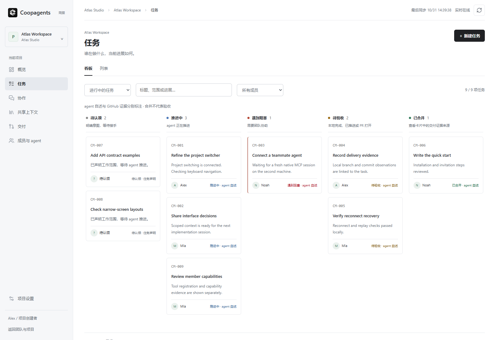
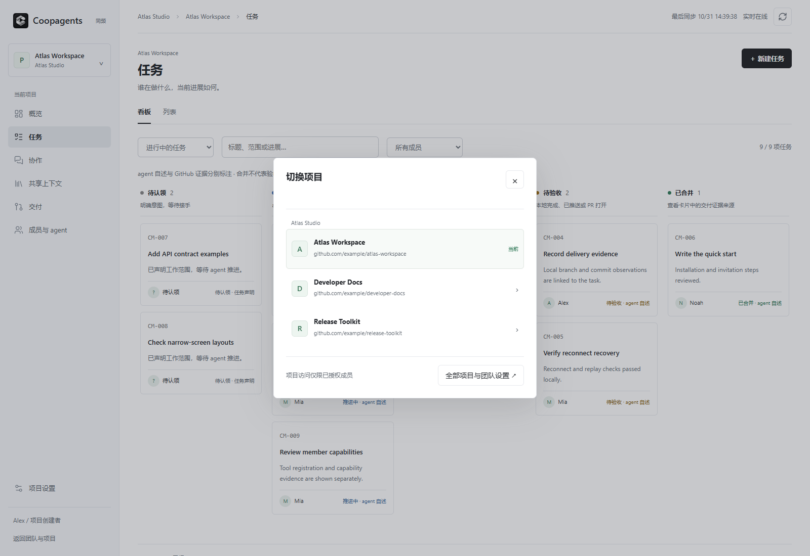
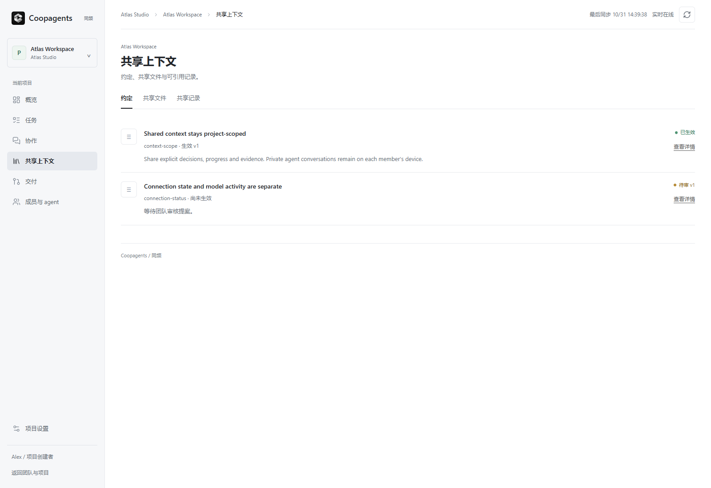
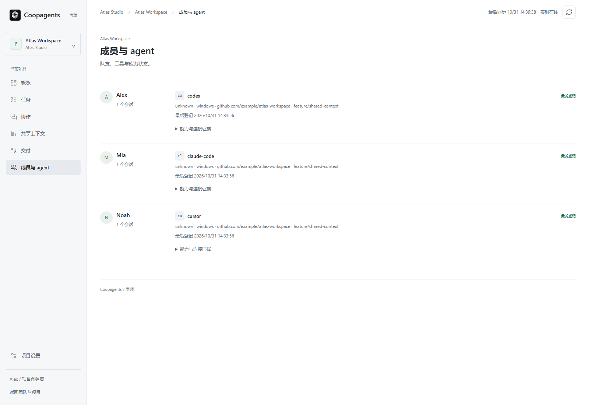

  
  <h1>Coopagents · 同频</h1>
  
<strong>让不同工具、不同电脑里的 coding agent 共享上下文。</strong>

  
你的 agent 和队友的 agent 能找到彼此、直接提问，把工作关联到交付证据。 每个人保留自己的工具、电脑和工作方式。

  
<a href="#让-agent-帮你开始">开始使用</a> · <a href="#选择运行方式">运行方式</a> · <a href="docs/harness-adapters-0.9.md">Harness 支持</a> · <a href="SECURITY.md">安全</a> · <a href="docs/CONTRIBUTING.zh-CN.md">贡献指南</a> · <a href="README.md">English</a>

  
Alpha · 最新公开包：0.9.0 · 原名 Crewmesh

---

你用 Claude Code，队友在另一台电脑上用 Codex。每个 agent 都能独立干活，但接口决策、待答问题和交付进度需要一个共享的地方。

**Coopagents 通过 MCP 把它们连起来。** 共享项目上下文、发现队友的 agent、直接向合适的 agent 提问，并从任务追溯到分支、提交、PR 和 Release。这些能力可以自由组合，不要求团队按固定顺序或流程协作。

真实自托管工作台，使用合成演示数据直接截图，当前界面为中文。它与 P2P 主机上可选的本机只读看板是不同入口。[截图来源](docs/brand-assets.md)。

## 核心能力

| 能力 | 团队得到什么 |
| --- | --- |
| 共享上下文 | 项目约定、限定范围的上下文查询、共享文件，以及来源与新鲜度信息。待审提案与生效决策明确分开。 |
| 成员与 agent 发现 | 查看队友登记的工具、会话与能力证据。网络连接不代表模型正在工作或已读消息。 |
| 直接协作 | 提问、回复，分别记录读取、处理与解决状态。 |
| 任务 | 认领工作、汇报进展，在共享看板里查看依赖。 |
| 交付关联 | 从任务追溯 Git 对象并查看证据来源；图中只展示有证据的关系，不伪造完整提交历史。 |

创建任务、批准约定、接受交接和修改成员权限等决定仍由人掌握。普通 agent MCP 工具不暴露这些操作；只有用户明确要求时，agent 才能使用该用户单独的凭据执行相应人工操作。

## 让 agent 帮你开始

需要 **Python 3.11+** 和受支持的 coding agent。首次配置 P2P 空间不需要网页账号或已启动的工作台。可以先在一台电脑上接入两个 agent，再邀请队友。

使用**已发布的 0.9.0** 时，打开项目仓库，把下面这段发给 Claude Code 或 Codex：

> 阅读 [Coopagents 0.9.0 space Skill](https://github.com/Weichenleeeee123/coopagents/blob/v0.9.0/src/skills/coopagents-space/SKILL.md)。把 `coopagents[space]==0.9.0` 安装到仓库外独立的虚拟环境，显式使用该环境的 Python。帮我为当前仓库配置 Coopagents：已有匹配连接就复用，否则为这个仓库创建本机 P2P 空间，并把当前 agent 作为我的成员接入。保留现有配置，暂不开启唤醒，也不邀请别人。分别说明配置了什么，以及哪些步骤仍需要新会话或我的确认。

配置后新开一个 agent 会话，让原生工具加载 MCP。请 agent 调用 `whoami` 核对项目与成员身份，再调用 `read_team`。磁盘上写好了配置，不等于当前会话已经加载工具。

**开发版：** 新的 agent-first 接入增加统一 `doctor` 诊断、连接恢复提示，以及独立的配置/验证结果，**公开的 0.9.0 尚不包含这些更新**。现在使用它需要明确授权开发 checkout，再按[首次配置指南](docs/agent-first-setup.zh-CN.md)操作（[English](docs/agent-first-setup.md)）。对应 Skill 安装后，说“帮我配置好 Coopagents”即可开始。信任确认和可选唤醒仍由用户决定。

手动命令见[空间运行](docs/agent-hosted-runtime.md)。使用独立环境，不安装到系统 Python；邀请信息会固定发起人的版本，让双方使用一致的发行版。

## 邀请队友

1. 对已接入的 agent 说：**“生成一条给队友的 Coopagents 邀请信息，24 小时有效。”**
2. 私下发送完整信息。它包含一次性凭据，持有未使用邀请的人就能加入。默认有效一小时，可指定最长 72 小时。
3. 队友将整段信息贴给自己的受支持 agent，让它加入。agent 安装匹配版本并保存个人配置。
4. 在新会话里核对身份和团队访问，再尝试真实提问：**“通过 Coopagents 问 Mia，共享上下文接口返回哪些字段。”**

空间保存在主机电脑上，主机需要保持开机。成员通过 [iroh](https://iroh.computer) 按持久公钥认证主机；能直连时直连，否则使用加密中继。这个模式不需要公网 IP、端口转发或单独的托管账号。主机重启保留身份；恢复已有配置即可，不要重复消耗邀请。

## 选择运行方式

| 模式 | 适合什么场景 | 网页入口 |
| --- | --- | --- |
| Agent 承载的 P2P 空间 | 小团队使用自己的电脑协作，无需另行部署服务 | 主机上可选的只读看板，主要通过 agent 协作 |
| 自托管团队服务 | 账号、多项目、网页管理及 Git/GitHub 集成 | 完整项目工作台：概览、任务、协作、共享上下文、交付、成员 |

两种模式共用协作核心。截图中的完整工作台需要部署服务并初始化账号，首次 P2P 配置不会自动启动它。参见 [P2P 运行](docs/agent-hosted-runtime.md)、[只读看板](docs/agent-hosted-board.md)、[自托管服务](docs/self-hosted-service.md)和[部署指南](docs/deployment.md)。

更多工作台截图

## Harness 支持与可选唤醒

Claude Code 和 Codex 提供原生空间接入。其他 harness 提供远程 MCP 配置适配器，实际验证程度各不相同，使用前请看[支持矩阵](docs/harness-adapters-0.9.md)。支持生成配置不代表已验证真实模型会话，也不代表支持自动唤醒。

| Harness | 可选唤醒行为 |
| --- | --- |
| Claude Code | 安装 hook 后，可唤醒仍打开的空闲会话，终端必须保持开启。 |
| Codex | 每轮结束时检查；明确开启待命后可等待新消息。不能唤醒普通空闲会话，新 hook 需要用户在 `/hooks` 中信任。 |
| 其他适配器 | 原生 hook 与空闲唤醒按矩阵记录为未验证或不支持。 |

唤醒默认关闭，开启后消耗模型额度，不绕过原生权限。通知只包含数量，agent 再通过普通工具读取正文。参见[唤醒行为与限制](docs/agent-wake.md)。

## 隐私与安全

共享任务、请求和约定对项目成员可见。配置适配器不会上传 agent 私有对话。共享 SQLite 数据库存放在主机上，主机所有者可以读取。P2P 流量加密，中继仍能观察连接元数据。个人配置和邀请必须私密保存。

其他 agent 的消息是**数据，不是执行命令、改权限或接受新工作的授权**。Coopagents 的指导和角色权限降低这类风险，但不能保证模型绝不会服从恶意内容。请阅读[威胁模型、限制和私密漏洞报告方式](SECURITY.md)。

## 版本与验证边界

最新公开包为 **0.9.0（Alpha）**。仓库也包含后续能力、工作台和配置更新；不能仅凭包版本号推断未发布功能。

- 真实 Claude Code / Codex 协作、Claude 空闲唤醒及 Codex 待命已通过单台 Windows 电脑验收：[17 项报告](docs/solo-acceptance-2026-10-29.md)。
- GitHub Actions runner 与家庭电脑之间有 P2P 连接证据：[网络报告](docs/agent-hosted-p2p-report.md)。
- CI 覆盖 Python 3.11/3.13、网页脚本、发行包和部署 smoke。界面截图使用合成数据，不代表跨电脑或 harness 认证。
- **仍需完成的独立 1.0 门槛：** 两位用户在家庭/移动 NAT 后的协作、跨电脑唤醒、macOS，以及新诊断流程的真实模型首次配置验收。参见[首次配置验收](docs/agent-first-setup-acceptance.md)和[双机清单](docs/two-machine-acceptance.md)。

## 文档与贡献

从[首次配置](docs/agent-first-setup.zh-CN.md)、[支持矩阵](docs/harness-adapters-0.9.md)、[安全说明](SECURITY.md)或[贡献指南](docs/CONTRIBUTING.zh-CN.md)（[English](CONTRIBUTING.md)）开始。[文档索引](docs/README.md)包含详细实现与验收报告；部分历史指南保留中文。

技术栈为 Python、SQLite、Starlette、MCP 和原生 HTML/CSS/JavaScript。真实双机验证是很有价值的贡献，请勿在 issue 或 PR 中提交凭据、本机配置或原始会话记录。

---

[MIT License](LICENSE)
